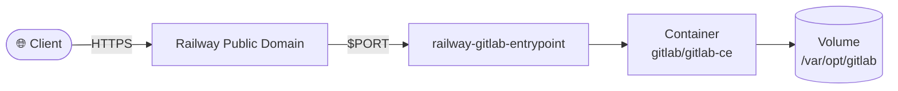

# GitLab CE

> [!IMPORTANT]
> **Requires at least 4 GB RAM (8 GB recommended) and 2 vCPU.** On Railway's Free or Trial plan GitLab is OOM-killed during its first `gitlab-ctl reconfigure` and the deploy fails. Use the **Hobby or Pro plan**. The first boot takes 10–20 minutes before the healthcheck passes. The template already applies GitLab's [memory-constrained settings](https://docs.gitlab.com/omnibus/settings/memory_constrained_envs/) (single Puma process, Sidekiq concurrency 10, Prometheus monitoring off).


Deploy a self-hosted GitLab CE instance on Railway.

[](https://railway.com/deploy/gitlab-ce?referralCode=2_sIT9&utm_medium=integration&utm_source=template&utm_campaign=generic)

## 🏗️ Architecture



## Files in this template

- `Dockerfile` uses the official `gitlab/gitlab-ce` image.
- `docker-entrypoint.sh` injects Railway domain and dynamic `$PORT`.
- `railway.toml` configures health checks, restart policy, and required volume mount.
- `persist-secrets.sh` keeps `gitlab-secrets.json` on the volume so encrypted data survives redeploys (see [Persistent storage](#persistent-storage)).
- `persist-ssh-host-keys.sh` keeps the SSH host keys on the volume so the host key stays the same across redeploys (see [SSH host keys](#ssh-host-keys)).

## Environment variables

```bash
GITLAB_ROOT_PASSWORD=replace-with-strong-password
```

`RAILWAY_PUBLIC_DOMAIN` and `PORT` are provided by Railway.

## Public domain setup

Railway does not auto-generate a public domain during template deploy.

After deploying this template:

1. Open the service in Railway.
2. Go to `Settings` -> `Networking` -> `Public Networking`.
3. Click `Generate Domain`.

Once generated, `RAILWAY_PUBLIC_DOMAIN` is available and used by the entrypoint.

## Post-deploy checklist

- [ ] Set a strong `GITLAB_ROOT_PASSWORD`.
- [ ] Generate a public domain in Railway (`Settings` -> `Networking` -> `Public Networking`).
- [ ] Attach a persistent volume and mount:
  - `/var/opt/gitlab`
  - `/etc/gitlab`
  - `/var/log/gitlab`
- [ ] Wait for first boot to complete before first login.

## Railway deploy runbook

Use this order to avoid blocked-host issues on first setup:

1. Deploy once.
2. Generate a public domain in Railway.
3. Deploy again (so `RAILWAY_PUBLIC_DOMAIN` is present at boot time).
4. Verify the application with:
   - `https://<your-domain>/users/sign_in`

## First login

- Username: `root`
- Password: value from `GITLAB_ROOT_PASSWORD`

## Persistent storage

Railway attaches **one** volume per service. `railway.toml` enforces it at `/var/opt/gitlab` via `requiredMountPath`. Everything else in the container, including `/etc/gitlab` and `/var/log/gitlab`, is recreated on every deploy.

### `gitlab-secrets.json`

GitLab encrypts CI/CD variables, personal access tokens, runner tokens, 2FA secrets and integrations with the keys in `/etc/gitlab/gitlab-secrets.json`. If that file is lost, GitLab generates new keys and the existing encrypted data can no longer be read.

At startup `persist-secrets.sh` therefore keeps the file on the volume at `/var/opt/gitlab/railway-secrets/gitlab-secrets.json` and links `/etc/gitlab/gitlab-secrets.json` to it:

- If the volume already has the file, it is always used. It is never overwritten. A different file found in `/etc/gitlab` is kept next to it as `gitlab-secrets.json.replaced-<timestamp>`.
- If only `/etc/gitlab` has the file (for example when `/etc/gitlab` is mounted as well), it is copied to the volume once.
- On a fresh install, GitLab generates the file directly on the volume.

You can change the location with `GITLAB_PERSISTENT_SECRETS_DIR`. It must be on the volume.

> [!IMPORTANT]
> **Existing instances (template ≤ 0.2.4):** the first deploy of this version still starts with a fresh `/etc/gitlab`. To keep the secrets your instance uses right now, copy them to the volume **before** you deploy the update, for example with `railway ssh`:
>
> ```bash
> mkdir -p /var/opt/gitlab/railway-secrets
> cp -p /etc/gitlab/gitlab-secrets.json /var/opt/gitlab/railway-secrets/
> chmod 700 /var/opt/gitlab/railway-secrets
> ```
>
> If an instance has already lost its secrets in an earlier redeploy, this fix cannot bring them back. CI/CD variables, access tokens and other data encrypted with the old keys stay invalid and have to be recreated. Runners have to be registered again. The [GitLab docs on lost secrets](https://docs.gitlab.com/administration/backup_restore/troubleshooting_backup_gitlab/#when-the-secrets-file-is-lost) explain how to reset them.

### SSH host keys

GitLab's SSH server identifies itself with the host keys in `/etc/gitlab/ssh_host_*`. If they change, every SSH client warns `REMOTE HOST IDENTIFICATION HAS CHANGED` and refuses to `git clone`/`git push` over SSH until the old entry is removed from `known_hosts`.

At startup `persist-ssh-host-keys.sh` therefore keeps the RSA, ECDSA and Ed25519 host keys on the volume at `/var/opt/gitlab/railway-ssh/` and links `/etc/gitlab/ssh_host_<type>_key` and `.pub` to them:

- Keys that already exist on the volume are always used and never overwritten. A different key found in `/etc/gitlab` is kept next to it as `ssh_host_<type>_key.replaced-<timestamp>`.
- If only `/etc/gitlab` has a key (for example when `/etc/gitlab` is mounted as well), it is copied to the volume once.
- On a fresh install, the keys are generated directly on the volume.

You can change the location with `GITLAB_PERSISTENT_SSH_DIR`. It must be on the volume.

> [!NOTE]
> **Existing instances (template ≤ 0.2.4 on this branch):** the first deploy of this version still starts with a fresh `/etc/gitlab`, so the host key changes one last time unless you copy the current keys to the volume **before** you deploy the update, for example with `railway ssh`:
>
> ```bash
> mkdir -p /var/opt/gitlab/railway-ssh
> cp -p /etc/gitlab/ssh_host_* /var/opt/gitlab/railway-ssh/
> chmod 700 /var/opt/gitlab/railway-ssh
> ```
>
> After that the host key stays the same across redeploys. Clients that already saw a changed key need `ssh-keygen -R <your-domain>` once.

## Notes

- Memory tuning (set in `docker-entrypoint.sh` following GitLab's [memory-constrained environment guide](https://docs.gitlab.com/omnibus/settings/memory_constrained_envs/)): `puma['worker_processes']=0`, `sidekiq['concurrency']=10`, `prometheus_monitoring['enable']=false` and jemalloc `MALLOC_CONF` decay for Rails. Override them via `GITLAB_OMNIBUS_CONFIG` only if you give the service more memory.
- GitLab needs significant RAM and CPU: plan for at least 4 GB RAM (8 GB recommended) and 2 vCPU. The first boot runs `gitlab-ctl reconfigure` and database migrations and can take 10-20 minutes before the healthcheck passes.
- First boot can take several minutes.
- Keep at least one persistent volume attached before storing projects.

## 💬 Support

Questions or feedback? Visit the [template forum on Railway Central Station](https://station.railway.com/templates/git-lab-ce-dbc250b4).

<!-- footer -->
---

[](https://github.com/vergissberlin/railwayapp-airbyte) [](https://github.com/vergissberlin/railwayapp-airflow) [](https://github.com/vergissberlin/railwayapp-cloudbeaver-ce) [](https://github.com/vergissberlin/railwayapp-codimd) [](https://github.com/vergissberlin/railwayapp-django) [](https://github.com/vergissberlin/railwayapp-email) [](https://github.com/vergissberlin/railwayapp-fastapi) [](https://github.com/vergissberlin/railwayapp-flask) [](https://github.com/vergissberlin/railwayapp-flowise) [](https://github.com/vergissberlin/railwayapp-gitlab) [](https://github.com/vergissberlin/railwayapp-grafana) [](https://github.com/vergissberlin/railwayapp-homeassistant) [](https://github.com/vergissberlin/railwayapp-influxdb) [](https://github.com/vergissberlin/railwayapp-mjml) [](https://github.com/vergissberlin/railwayapp-mongodb) [](https://github.com/vergissberlin/railwayapp-mqtt) [](https://github.com/vergissberlin/railwayapp-mysql) [](https://github.com/vergissberlin/railwayapp-n8n) [](https://github.com/vergissberlin/railwayapp-nodejs) [](https://github.com/vergissberlin/railwayapp-nodered) [](https://github.com/vergissberlin/railwayapp-opensearch) [](https://github.com/vergissberlin/railwayapp-openwebui) [](https://github.com/vergissberlin/railwayapp-operately) [](https://github.com/vergissberlin/railwayapp-outerbase-studio) [](https://github.com/vergissberlin/railwayapp-postgresql) [](https://github.com/vergissberlin/railwayapp-redis) [](https://github.com/vergissberlin/railwayapp-typo3)
